<picture>
  <source media="(prefers-color-scheme: dark)" srcset="assets/header-dark.svg">
  
</picture>

### Hi, I'm Tomas 👋

I commute around Europe: Finland, Czechia, Estonia.
I enjoy Go, PHP, Node.js/TypeScript and C#, and I pick whatever fits the job.
My philosophy is laziness as productivity: automate the boring parts, keep a human in the loop.
Most of what I build is open source: MCP servers, Claude Code plugins,
a hosting platform for agent-built apps and a pixel-art game portal.

**Products**

- 📊 [Metrifyr](https://www.metrifyr.com): your marketing data for AI agents, over MCP. GA4, Search Console, Tag Manager, AdSense, PageSpeed and keyword research in one connector for Claude, Cursor and friends. Built because I kept doing the same GA4 digging by hand.
- 🎮 [PixelDen](https://www.pixelden.io): browser games portal, pixel art made with AI tooling
- 🍞 [drobek](https://github.com/freema/drobek): self-hosted vibe coding hosting. Your agent writes the frontend over MCP, the backend is platform modules: auth, data, forms, email, files and an API proxy with server-side secrets. AGPL-3.0 · [drobek.app](https://drobek.app)
- ⚒️ [codeforge](https://github.com/freema/codeforge): AI coding sessions over git repos (Claude Code, Codex, Cursor) on a server, with live stream, cost tracking and PR review

**MCP servers**

- 🦊 [firefox-devtools-mcp](https://github.com/mozilla/firefox-devtools-mcp): inspect and control Firefox via WebDriver BiDi, now under Mozilla
- 🦞 [openclaw-mcp](https://github.com/freema/openclaw-mcp): bridge between Claude.ai and a self-hosted OpenClaw assistant, with OAuth
- 📗 [mcp-gsheets](https://github.com/freema/mcp-gsheets): read, write and manage Google Sheets from Claude, Cursor and friends
- 🎨 [mcp-design-system-extractor](https://github.com/freema/mcp-design-system-extractor): lets agents read your Storybook design system
- 📝 [vellum](https://github.com/freema/vellum): self-hosted MCP server over a folder of markdown, one Go binary, no DB

**Also:** [cursor-plugin-cc](https://github.com/freema/cursor-plugin-cc) · [mcp-jira-stdio](https://github.com/freema/mcp-jira-stdio) · [pixelforge-mcp](https://github.com/freema/pixelforge-mcp) · [openclaw-a2a](https://github.com/freema/openclaw-a2a) · [ai-skills](https://github.com/freema/ai-skills)

**Shooting down my last year**

<picture>
  <source media="(prefers-color-scheme: dark)" srcset="assets/contributions-dark.svg">
  
</picture>

**Latest writing**

<!-- BLOG-POST-LIST:START -->
- [Claude Code built the app. I refused to let it publish itself.](https://dev.to/freema/claude-code-built-the-app-i-refused-to-let-it-publish-itself-718)
- [Your AI-built app wants your API key. I built drobek so it never gets it.](https://dev.to/freema/your-ai-built-app-wants-your-api-key-i-built-drobek-so-it-never-gets-it-4oj5)
- [The AI artifact was useful. Then someone wanted to keep using it.](https://dev.to/freema/the-ai-artifact-was-useful-then-someone-wanted-to-keep-using-it-2e80)
<!-- BLOG-POST-LIST:END -->

🌐 [tomasgrasl.cz](https://www.tomasgrasl.cz) · ✍️ [dev.to](https://dev.to/freema) · 💬 [/dev/null](https://dev-null.sh/@freema) · 🦋 [Bluesky](https://bsky.app/profile/grasl.bsky.social) · 𝕏 [@GraslT](https://x.com/GraslT)
